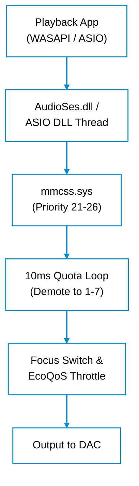
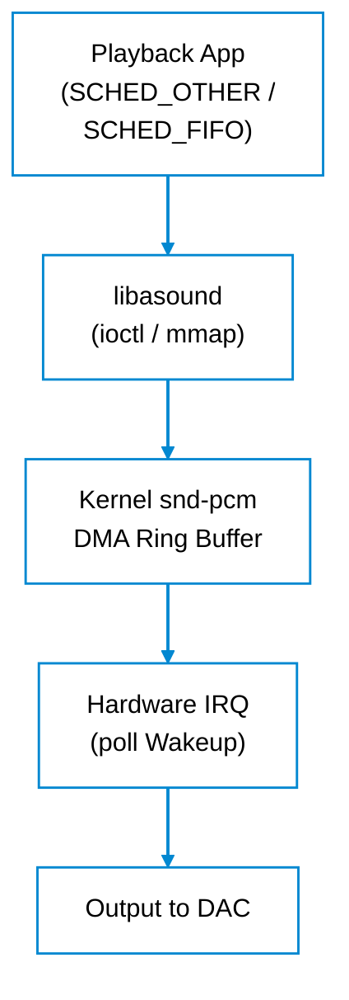

[English](alsa_vs_mmcss.md) | [日本語](alsa_vs_mmcss_ja.md)

---

# Scheduling Architecture Comparison: Windows (MMCSS + WASAPI / ASIO) vs. Linux (ALSA)

This reference contrasts the verified behavior of Windows 11 `mmcss.sys` (`10.0.26100.x`, confirmed via binary disassembly and live kernel tests) against **Linux ALSA (Advanced Linux Sound Architecture)** in terms of thread scheduling, driver structure, and OS background intervention.

---

## 1. Summary: Fundamental Design Difference

The core difference between **Windows (MMCSS + WASAPI / ASIO)** and **Linux (ALSA `hw:` direct output)** is **whether audio I/O and thread priority management are coupled or decoupled**:

- **Windows (MMCSS + WASAPI / ASIO)**:
  Windows audio stack components (`AudioSes.dll`, `audiodg.exe`) and major third-party ASIO driver DLLs register worker threads with MMCSS independently of player settings. Once registered, the kernel driver `mmcss.sys` continuously manages priority elevation, 10 ms quota demotions, and foreground/background transitions.
- **Linux (ALSA `hw:` direct output)**:
  ALSA itself (`libasound` / kernel `snd-pcm`) handles pure DMA ring-buffer I/O and interrupt waits (`ioctl` / `mmap` / `poll`). It **never automatically raises or oscillates thread priorities**. Realtime scheduling (`SCHED_FIFO` / `SCHED_RR`) is applied only when an application or audio daemon explicitly requests it via POSIX/Linux APIs.

---

## 2. Architecture Comparison Matrix

| Comparison Axis | Windows (MMCSS + WASAPI / ASIO) | Linux (ALSA `hw:` Direct Output) |
| :--- | :--- | :--- |
| **Automatic Priority Intervention by Audio API** | **Yes.** `AudioSes.dll` (`Audio`) and major ASIO DLLs (`Pro Audio`) call `AvSetMmThreadCharacteristicsW` internally, elevating threads to MMCSS priorities (`21–26`). | **No.** ALSA (`libasound` / `snd-pcm`) only performs DMA buffer reads/writes and interrupt waits without changing thread priority. |
| **How Realtime Priority Is Enabled** | An app or driver DLL calls `AvSetMmThreadCharacteristicsW` / `AvSetMmThreadPriority`, delegating priority control to `mmcss.sys`. | Only when the app (or JACK / PipeWire) explicitly calls `sched_setscheduler` / `pthread_setschedparam` (`SCHED_FIFO` / `SCHED_RR`). Otherwise runs under standard `SCHED_OTHER` (CFS / EEVDF). |
| **Periodic Runtime Priority Rewrites** | **Yes (`High` / `Medium`).** `mmcss.sys` evaluates threads on a **10 ms cycle**; after consuming the quota (default 8 ms), threads are demoted to `1–7` for the remaining 2 ms. | **None.** `SCHED_OTHER` is outside RT throttling. Even under `SCHED_FIFO`, priority remains fixed unless CPU usage exceeds `sched_rt_runtime_us` (default 0.95 s per 1.0 s period). |
| **Foreground / Background Behavior Changes** | **Yes.** Background transitions trigger `mmcss.sys` priority restoration plus Windows **EcoQoS (Power Throttling)**, restricting CPU clocks, quanta, and timer resolution. | **No.** The Linux kernel does not throttle CPU slices or timer resolution based on GUI window focus (unless explicitly restricted via cgroups). |
| **Driver Threading Model** | ASIO vendor COM DLLs load into the app process and spawn their own buffer-transfer worker threads (which may call MMCSS). | `libasound` (`hw:`) typically executes I/O directly on the app's thread; hardware interrupts are handled in kernel space by IRQ handlers (or `irq/*` threads under `threadirqs`). |
| **CPU Core Isolation Mechanisms** | Process/thread affinity masks (`SetThreadAffinityMask`, controlled via tools such as ATI). | `taskset`, `sched_setaffinity`, and kernel boot parameters (`isolcpus`, `irqaffinity`). |

---

## 3. Execution Pipeline Diagrams

### Windows (Default MMCSS Active)

### Linux (ALSA `hw:` Direct Output)

---

## 4. Detailed Comparison Across Four Key Areas

### 4.1 Decoupling of Audio I/O and Thread Priority Control
- **Windows**:
  In both WASAPI Exclusive and Shared modes, `AudioSes.dll` and `audiodg.exe` invoke `AvSetMmThreadCharacteristicsW(L"Audio", ...)` internally. Likewise, major user-mode ASIO driver DLLs (such as Thesycon TUSBAudio and RME) call `AvSetMmThreadCharacteristicsW(L"Pro Audio", ...)` on their internal buffer-transfer worker threads. Disabling MMCSS in a media player's GUI therefore does not stop OS or driver DLLs from invoking MMCSS.
- **Linux**:
  When outputting directly to an ALSA `hw:` device, `libasound` executes `ioctl` / `mmap` directly on the caller's thread without altering its scheduling policy. Realtime scheduling is applied only if the app or audio server (JACK / PipeWire) explicitly requests `SCHED_FIFO` / `SCHED_RR`.

### 4.2 CPU Starvation Safeguards (10 ms Cycle vs. 1 s Window)
- **Windows (`mmcss.sys`)**:
  Threads registered under `High` or `Medium` join a 10 ms scheduler evaluation loop. Under `SystemResponsiveness` (default `20%`), consuming 8 ms within the 10 ms window demotes the thread to exhausted priority (`1–7`) for the remaining 2 ms, then elevates it back to `21–26` on the next 10 ms cycle.
- **Linux (RT Throttling)**:
  Regular `SCHED_OTHER` threads do not use the realtime scheduling class at all. Even when `SCHED_FIFO` / `SCHED_RR` is explicitly requested, Linux kernel RT throttling evaluates over `kernel.sched_rt_period_us` (default `1,000,000 µs` = 1 s) with `kernel.sched_rt_runtime_us` (default `950,000 µs` = 95%), so typical audio playback loads never trigger dynamic priority oscillation.

### 4.3 Foreground / Background Transitions & Power Throttling (EcoQoS)
- **Windows**:
  1. Window focus notifications cause `mmcss.sys` to revert `High` / `Medium` threads to their pre-MMCSS priority when backgrounded.
  2. Windows 10/11 PPM (Processor Power Management) automatically applies **EcoQoS (Power Throttling)** to minimized or backgrounded processes—limiting CPU clocks/quanta (`PROCESS_POWER_THROTTLING_EXECUTION_SPEED = 0x1`) and ignoring high-resolution timer requests (`PROCESS_POWER_THROTTLING_IGNORE_TIMER_RESOLUTION = 0x4`) without changing visible priority numbers.
- **Linux**:
  The Linux kernel has no built-in mechanism that automatically throttles a process's time slices or timer resolution based on GUI window focus.

### 4.4 Achieving ALSA-Like Flat Scheduling on Windows
Combining three mechanisms brings Windows structurally close to **Linux ALSA `hw:` + `taskset` / `isolcpus`**:

1. **MMCSS Task Disable (`Scheduling Category = "Dummy"`)**:
   `mmcss.sys` rejects undefined category strings with `STATUS_INVALID_PARAMETER (0xC000000D)` and drops the task key. `AvSetMmThreadCharacteristicsW` fails with `LastError = 1550 (ERROR_INVALID_TASK_NAME)` and `AvSetMmThreadPriority` is also bypassed, keeping threads at their native Win32 priority (e.g., `8` for `audiodg.exe`) with no 10 ms demotion loop.
2. **EcoQoS (Power Throttling) Bypass**:
   Using `SetProcessInformation(ProcessPowerThrottling)` (`StateMask = 0`, applied automatically by ATI) or OS policy prevents background speed throttling and timer-resolution ignoring.
3. **ATI Single-Core Isolation**:
   With MMCSS disabled, pinning audio threads to dedicated CPU cores while evicting other threads and processes to separate cores yields flat, contention-free execution.
