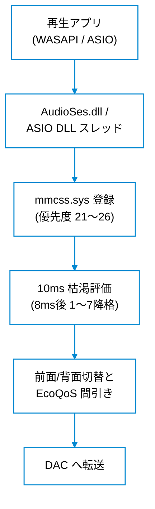
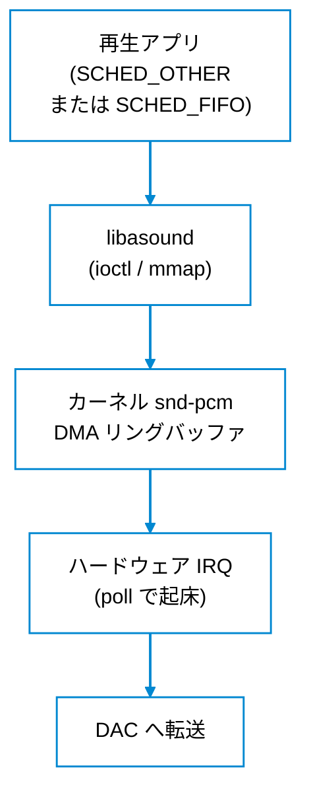

[English](alsa_vs_mmcss.md) | [日本語](alsa_vs_mmcss_ja.md)

---

# Windows（MMCSS ＋ WASAPI / ASIO）と Linux（ALSA）のスケジューリング比較

本書は、Windows 11 の `mmcss.sys`（`10.0.26100.x`）逆アセンブルおよび実機カーネル検証によって確定した MMCSS の動作仕様と、Linux の **ALSA（Advanced Linux Sound Architecture）** におけるスレッドスケジューリング・ドライバ構造の違いを対比・整理した資料です。

---

## 1. 結論（設計思想の根本的な違い）

Windows の **MMCSS（＋WASAPI / ASIO）** と Linux の **ALSA（特に `hw:` 直接出力）** の最大の違いは、**「オーディオ I/O 層とスレッド優先度制御が結合されているか、分離されているか」** にあります。

- **Windows（MMCSS ＋ WASAPI / ASIO）**:
  OS のオーディオスタック（`AudioSes.dll` / `audiodg.exe`）やサードパーティ製 ASIO ドライバ DLL が、アプリケーション側の設定とは独立して裏側で MMCSS へスレッドを登録します。登録されたスレッドは、カーネルドライバ `mmcss.sys` によって継続的に優先度書き換え・10ms 周期の枯渇評価・前面／背面切替の介入を受けます。
- **Linux（ALSA `hw:` 直接出力）**:
  ALSA 自身（`libasound` / カーネル `snd-pcm`）は純粋な DMA リングバッファ I/O と割り込み待機（`ioctl` / `mmap` / `poll`）のみを担当し、**スレッドの優先度を勝手に引き上げたり、周期的に上下させたりする機構を持ちません**。リアルタイム優先度を使うかどうかは、アプリやオーディオデーモン側が POSIX / Linux 標準 API を明示的に呼び出すかどうかで決まります。

---

## 2. アーキテクチャ対比マトリクス

| 比較項目 | Windows（MMCSS ＋ WASAPI / ASIO） | Linux（ALSA `hw:` 直接出力） |
| :--- | :--- | :--- |
| **オーディオ API による自動優先度介入** | **あり**。 `AudioSes.dll`（`Audio`）や主要 ASIO DLL（`Pro Audio`）が独自スレッドで `AvSetMmThreadCharacteristicsW` を呼び出し、MMCSS 優先度（`21〜26`）へ引き上げる。 | **なし**。 ALSA（`libasound` / `snd-pcm`）は DMA バッファの読み書きと割り込み待機のみを行い、スレッド優先度を自動変更しない。 |
| **リアルタイム優先度の有効化手段** | アプリまたはドライバ DLL が `AvSetMmThreadCharacteristicsW` / `AvSetMmThreadPriority` を呼び、`mmcss.sys` が優先度を管理する。 | アプリ（または JACK / PipeWire 等）が明示的に `sched_setscheduler` / `pthread_setschedparam` 等で `SCHED_FIFO` / `SCHED_RR` を指定した場合のみ。未指定時は通常の `SCHED_OTHER`（CFS / EEVDF）で走行。 |
| **実行中の周期的な優先度書き換え** | **あり**（`High` / `Medium`）。 `mmcss.sys` が **10ms 周期** で監視し、持ち時間（既定 8ms）を使い切ると残り 2ms 間だけ優先度 `1〜7` へ一時降格させる。 | **定期的な優先度上下なし**。 `SCHED_OTHER` は RT 枠外。`SCHED_FIFO` でも `sched_rt_runtime_us`（既定：1 秒あたり 0.95 秒）を超過しない限り優先度は固定維持される。 |
| **前面／背面移行時の挙動変化** | **あり**。 背面移行時に `mmcss.sys` が参加前の OS 優先度へ戻す切替を行い、さらに OS の **EcoQoS（Power Throttling）** による実行速度制限やタイマー解像度無視が発動する。 | **なし**。 Linux カーネルは GUI ウィンドウのアクティブ／非アクティブ状態でプロセスのタイムスライスやタイマー精度を自動削減しない（cgroups での明示制限を除く）。 |
| **ドライバ構造とスレッド生成** | ASIO はベンダー製ユーザーモード COM DLL がアプリプロセス内にロードされ、独自のバッファ転送ワーカースレッドを生成する。 | `libasound`（`hw:` 直結）は原則アプリ自身のスレッド上で同期／非同期 I/O を実行する。ハードウェア割り込みはカーネル空間の IRQ ハンドラ（`threadirqs` 有効時は `irq/*` カーネルスレッド）が担う。 |
| **CPU コア固定（隔離）の標準手段** | プロセス／スレッドのアフィニティマスク（`SetThreadAffinityMask` 等。ATI などの外部ツールで制御）。 | `taskset` / `sched_setaffinity` / カーネル起動パラメータ `isolcpus` / `irqaffinity` 等でユーザー・カーネル両面から明示指定可能。 |

---

## 3. 処理構造の比較図

### Windows（既定の MMCSS 有効時）

### Linux（ALSA `hw:` 直接出力）

---

## 4. 4 つの主要論点の詳細比較

### 4.1 オーディオ API とスレッド優先度制御の分離
- **Windows**:
  WASAPI 排他・共有モードでは `AudioSes.dll` や `audiodg.exe` が内部で `AvSetMmThreadCharacteristicsW(L"Audio", ...)` を呼び出します。また、ASIO 出力でも Thesycon（TUSBAudio 系）や RME などのユーザーモード ASIO DLL が内部ワーカースレッドで `AvSetMmThreadCharacteristicsW(L"Pro Audio", ...)` を呼び出します。そのため、再生アプリの設定で MMCSS をオフにしても、OS やドライバ DLL 経由で MMCSS が自動的に発動します。
- **Linux**:
  ALSA の `hw:` デバイスへ直接出力する場合、`libasound` はアプリのスレッド上でそのままカーネルの `snd-pcm` へ `ioctl` / `mmap` を行うだけであり、優先度を変更しません。リアルタイム優先度が必要な場合は、アプリやオーディオサーバ（JACK / PipeWire）が明示的に `SCHED_FIFO` 等を要求します。

### 4.2 CPU 占有防止セーフティネットの違い（10ms 周期 vs 1 秒周期）
- **Windows（`mmcss.sys`）**:
  `Scheduling Category` が `High` または `Medium` のスレッドは 10ms 周期のスケジューラループへ組み込まれます。`SystemResponsiveness`（既定 `20%`）により、10ms 枠内で 8ms 消費すると残り 2ms 間は枯渇優先度（`1〜7`）へ一時降格され、次の 10ms 周期で再び `21〜26` へ引き戻されます。
- **Linux（RT スロットリング）**:
  通常の `SCHED_OTHER` スレッドとして ALSA を利用している場合、リアルタイム枠自体を使用しないためスロットリングは関与しません。`SCHED_FIFO` / `SCHED_RR` を明示指定した場合でも、Linux カーネルの保護機構は `kernel.sched_rt_period_us`（既定 1,000,000 µs = 1 秒）あたり `kernel.sched_rt_runtime_us`（既定 950,000 µs = 95%）という大きな枠で判定するため、通常のオーディオ再生負荷（数%）で優先度が動的に上下することはありません。

### 4.3 ウィンドウの前面／背面遷移と省電力制御（EcoQoS）
- **Windows**:
  1. `mmcss.sys` がウィンドウ状態通知を受けると、`High` / `Medium` のスレッドを MMCSS 参加前の元の OS 優先度へ戻す切替処理が走ります。
  2. Windows 10/11 の PPM（Processor Power Management）は、最小化・背面化したプロセスへ自動的に **EcoQoS（Power Throttling）** を適用します。`PROCESS_POWER_THROTTLING_EXECUTION_SPEED (0x1)` によるクロック・クォンタム制限や `PROCESS_POWER_THROTTLING_IGNORE_TIMER_RESOLUTION (0x4)` によるタイマー解像度要求の無視が、見かけの優先度数値を変えないまま発生します。
- **Linux**:
  デスクトップ上のウィンドウが前面にあるか背面・最小化されているかによって、カーネルが特定プロセスのスレッド優先度・タイムスライス・タイマー精度を自動で制限する仕組みは標準では存在しません。

### 4.4 Windows で ALSA `hw:` 直結に近いフラットな動作を実現する構成
Windows 環境で以下の 3 要素を組み合わせる構成は、構造的に Linux の **ALSA `hw:` 直結 ＋ `taskset` / `isolcpus`（CPU コア固定）** に近いフラットな実行状態へ近づけるアプローチに相当します。

1. **MMCSS レジストリへの `"Dummy"` 指定（`Scheduling Category = "Dummy"`）**:
   `mmcss.sys` の設定読込関数が未定義文字列に対して `STATUS_INVALID_PARAMETER (0xC000000D)` を返してタスク登録自体を破棄します。結果として `AvSetMmThreadCharacteristicsW` は `LastError = 1550 (ERROR_INVALID_TASK_NAME)` で失敗し、`AvSetMmThreadPriority` も無効化されます。これにより、アプリやドライバ DLL からの勝手な優先度引き上げ（`21〜26`）と 10ms 枯渇降格ループが遮断され、スレッド本来の優先度（`audiodg.exe` なら `8` 等）が維持されます。
2. **EcoQoS（Power Throttling）の解除**:
   プロセス単位の `SetProcessInformation(ProcessPowerThrottling)`（`StateMask = 0`）または OS 設定により、背面移行時の実行速度制限とタイマー解像度無視を抑止します。
3. **ATI（Audio Thread Isolator）による単一コア隔離**:
   MMCSS による介入を止めた状態で、オーディオ処理スレッドを専用 CPU コアへ隔離し、他スレッドを別コアへ退避させることで、スケジューリング競合のないフラットな実行環境を維持します。
